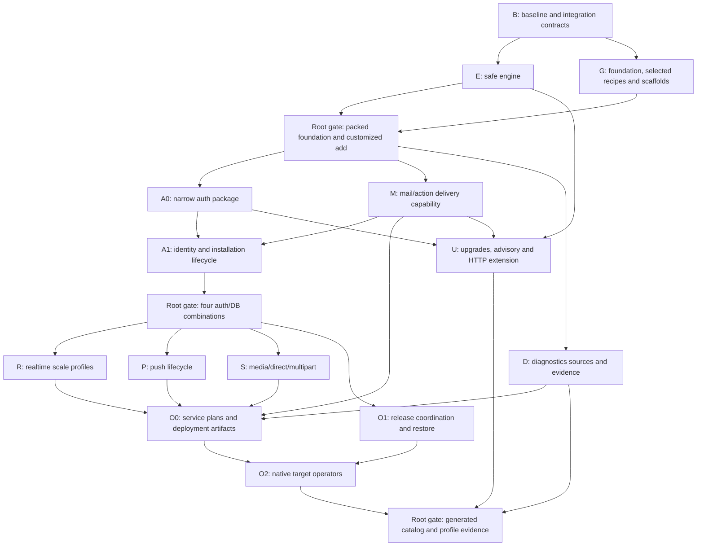

# Full CLI phase gap review

Review date: 17 November 2026. Scope: all active phase README/TASKS/ACCEPTANCE registers, PRODUCT REQ-01–22, current decisions/architecture/verification, implementation contract, both native reference READMEs, capability/repository documents, current verification records, and selected source inspection. This is an implementation handoff, not a second phase-status register or an acceptance result.

Only this report was written. No application test, build, install, service, browser, provider operation, commit, or publication was run. Source/configuration are changing concurrently: the initial CLI inspection contained `src/contracts.ts` and the root package/tool configuration; reference-derived templates appeared during the audit. The gaps below describe the inspected reference baseline and the required final behavior, not a verdict on work arriving from the current engine/recipes workers.

## Findings that determine the sequence

The references are useful implementation inputs. Each has a selected native database, inherited repositories, strict input mapping, acyclic flat modules, local authentication, Firebase authority checks, session/refresh/action transitions, single-instance realtime, private mediated media, SMTP/capture, purpose-routed push, and application-only retained diagnostics. Their current native database, HTTP/protocol and browser/restart evidence belongs to those hand-built apps. None passes an init/add/pack/generated-app gate.

The CLI needs more than extracting those files. Missing source includes the narrow authentication patch package, additional identity/installation/provider lifecycles, shared realtime mechanisms, complete mail/action-delivery contracts, direct/multipart storage workflows, additional diagnostic sources and test evidence, coordinated release operations, platform operators, and upgrades. Some existing mechanisms need stronger tests or selected-output integration rather than replacement.

The active owner decision is full CLI source implementation and local acceptance through all phases. Old statements that implementation has not started or that preparing the plan grants no permission are historical/status text; they do not require renewed permission for this authorized work. Publication, provisioning, production migration and deployment remain separate actions. Root should reconcile stale active status prose when recording actual evidence, without converting references into generator acceptance.

### Frozen Firebase enrollment contract

The coordinator supplied this implementation decision during the review:

- A client creates a cryptographically random capability with at least 256 bits for each intended application session and reuses that capability across bootstrap retries.
- The backend stores only its hash, uniquely bound to the verified Firebase subject and immutable enrollment generation. Concurrent bootstrap for the same subject/capability yields one stable session and installation.
- An authorized capability survives Firebase ID-token refresh. A revoked capability never reactivates. A different capability still needs recent `auth_time` and the atomic durable enrollment cutoff.
- Implement this in the future bundled output/runtime, leaving reviewed reference source/evidence intact. Capability values stay out of logs, plans and generic diagnostics.

This resolves a real reference/phase difference: reference `firebase-identity.controller.ts` generates a new server secret on every bootstrap and cannot recover the same enrollment after a lost response. P03-A02 requires raced subject/capability idempotence. Update the selected bootstrap body, returned safe session facts, `X-Session-Token` usage, strict Zod/OpenAPI schemas, client secret-store/retry instructions and concurrency/lost-response/revoked-capability regressions together. Do not add a second Firebase API JWT pair.

## What already exists, and what it does not establish

| Area                         | Inspected implementation/evidence                                                                                                                                                                                                                        | Remaining required behavior or gate                                                                                                                                                                                                                                                                     |
| ---------------------------- | -------------------------------------------------------------------------------------------------------------------------------------------------------------------------------------------------------------------------------------------------------- | ------------------------------------------------------------------------------------------------------------------------------------------------------------------------------------------------------------------------------------------------------------------------------------------------------- |
| Native persistence           | Separate Mongo/Mongoose and PostgreSQL/Drizzle+pg apps; rich inherited native repositories, projections, bounded page/iteration, transaction contexts and guarded owner operations. Current real-DB acceptance is recorded separately in each reference. | Emit exactly one native closure and preserve its specialized invariants in generated output; four auth/DB combinations, selected migrations and packed-output installation/runtime remain CLI gates. No new universal repository/filter layer is needed.                                                |
| Local authentication         | Argon2id resource bounds, dummy verification, rehash detection, Unicode/input bounds, strict hashed single-use refresh/action tokens, current-session JWT checks, credential versions, cutoff and scoped session revocation.                             | Versioned patch package; tested rotation/compromise policy; measured flood/health budgets and selected config; real changed-policy rehash and shared-rate/outage evidence; executable singleflight/client action examples.                                                                              |
| Rate limits                  | Durable DB buckets, hashed peer/identity keys, fixed windows, shared-limiter DB tests and fail-closed storage behavior. This is already present.                                                                                                         | Preserve the semantics; test separate processes, boundary/stale-window cases, known/unknown-account public mapping, storage failure and hashing pressure. Trusted ingress peer policy needs explicit deployment mapping. Redis is not required for this behavior.                                       |
| Firebase                     | Real Admin SDK verifier with revoked/disabled/unavailable distinctions; method allowlist, phone-only metadata, recent auth and application cutoff checks; synthetic-policy and native persistence tests.                                                 | Frozen retry-stable enrollment; durable guarded provider cleanup intent; explicit linking/unlinking/deletion policy and implementation; real four-method/client acceptance. Ordinary scoped session revocation must not accidentally call account-wide Firebase revocation and kill surviving siblings. |
| Installations/push ownership | Every login creates a fresh generation-one installation. Push has bounded aggregate persistence, token deduplication, exact-generation cleanup, rechecks and account-binding tests.                                                                      | Stable installation reuse/rebind/recovery and old-work fencing across all consumers. Existing store-level binding tests are not an exposed rebind workflow. Keep token registration session policy explicit.                                                                                            |
| Realtime                     | Socket.IO and native ws have real local protocol checks; one-use tickets are process-local Maps. Centrifugo has private API/proxy adapters, connect/refresh envelopes, separate secrets and fake-protocol tests.                                         | Real Centrifugo service/SDK acceptance; selected multi-instance fanout/engine, shared atomic ticket consumption, cross-node authority/restart/drain evidence, load-balancer configuration and bounded failure tests.                                                                                    |
| Mail                         | Provider-neutral text escaping helper, private bounded capture and Nodemailer SMTP; one-recipient action semantics, typed captured/accepted/rejected/unavailable/unknown outcomes; actual loopback SMTP evidence.                                        | Template/version/variable/locale and asset contract; richer retry-after/per-recipient semantics where offered; both Firebase action modes and client handling; durable protected delivery intent where required. SMTP/inbox evidence remains separate.                                                  |
| Push                         | Firebase Admin ordinary delivery and direct APNs ordinary/background/VoIP mechanics, bounded retries, expiry and exact-generation invalidation.                                                                                                          | Generated selected closure, provider/client setup and device evidence; retry-after/outcome classifications and rebind interactions need acceptance. Existing bounded synchronous retry does not require a universal queue.                                                                              |
| Media                        | Private streamed local staging, atomic quota reservation, immutable local hard-link finalization; conditional S3 PUT, full-object hash readback and recoverable durable finalizing/deleting state.                                                       | Direct bounded grants, backend-owned multipart and exact immutable completion evidence; abandoned/unknown completion recovery; live AWS plus named compatible conformance and browser CORS/header evidence.                                                                                             |
| Diagnostics                  | Pino allowlisting/context; independent bounded JSONL writer/reader; scoped local stdio MCP with five tools; Vector 0.62.0 transform tests and native Logdy 0.17.1 loopback feed previously passed.                                                       | Worker/DB/infrastructure parse/redaction/retention; `tests.getResult` and capture; stronger topology/viewer/reconnect/overload evidence; scoped remote profile and stronger isolation evidence if advertised. The native feed does not certify Docker host-gateway networking.                          |
| Operations                   | Thin Make/Nest commands, selected Compose examples, non-root Dockerfile, separate target artifacts/manual runbooks, explicit all-owner schema setup and backup/restore instructions.                                                                     | Selected service-plan rendering; release-wide locks/versioned history/recovery; authenticated native target discovery/apply/verify operators; actual image/routing/persistence/restore/scale evidence. Per-owner setup locks already exist, but are not whole-release coordination.                     |
| Maintenance                  | Dependency pins and documented copied-source patch responsibility.                                                                                                                                                                                       | Version/support inventory, upgrade plans/apply/recovery, named guarded codemod/manual fallback, advisories and independent HTTP mail adapter exercise. There is no released upgrade engine in the references.                                                                                           |

Evidence details are in [Mongo verification](../examples/reference-api/docs/VERIFICATION.md) and [PostgreSQL verification](../examples/reference-api-postgres/docs/VERIFICATION.md). Mongo records 146 passes and one optional skip; PostgreSQL records 147 passes and one optional skip; each records three assembled HTTP/protocol journeys and browser/restart checks. These are reported source records, not checks rerun by this audit.

## Required gates versus conditional alternatives

- Required families remain both DBs, both identity modes, all four Firebase methods, three realtime transports, SMTP/capture and both Firebase action-email choices, FCM/direct APNs purposes, local/AWS/one named compatible storage profile, Vector/Logdy/retained scoped diagnostics, three platform artifact/operator targets and the upgrade/extension proof.
- Multi-instance mechanisms are a required Phase 04 work item; each advertised cluster profile must pass separate-node acceptance. A single-instance profile stays useful but does not complete the scale-out task. No default Redis dependency is justified for the foundation or a single-instance transport.
- Direct Centrifugo JWT grants, polling Socket.IO, presence, retained replay, cookie-based auth/CSRF and arbitrary compatible S3 endpoints are conditional alternatives. Reject unimplemented selections. Their absence must not be confused with absence of required proxy admission/native tickets/core transports.
- Key rotation and compromised-key response need an implemented, tested policy. The reference documents hard replacement plus reauthentication with one fixed key ID; overlapping key rings are not universally mandated by the phase. If overlap is offered, separately test allowed IDs, retirement and positive/negative controls. Do not call rotation completely absent or silently promise overlap.
- Password work factors, bounded concurrency, dummy verification and durable rate buckets already exist. Promote their policy/configuration and evidence; do not replace them with an additional authentication framework or limiter backend by default.
- Reliable provider revoke/delete intent is required by P03-T04/P03-A05. It is distinct from every local session revoke. Durable mail dispatch is needed when the chosen action workflow promises retained/retryable delivery; protect usable links with encrypted/minimal bounded retention. A generic outbox, campaign system, push queue, durable realtime replay and worker framework are not requirements for every app.
- Phase 06 explicitly includes direct transfer and verified multipart work, but provider/mode support is a matrix. Reject unsafe/unimplemented modes for a named profile rather than weakening immutability or pre-transfer limits. A compatible provider need not pretend to implement every AWS field/operation.
- Same-user local diagnostics is a valid honest profile. A sandbox claim is conditional on actual OS/network/credential enforcement. A declared remote profile still needs scoped endpoint/read-credential behavior and negative tests; remote credentials or production mutation privileges must never be inherited implicitly.
- Public plugins, marketplaces, arbitrary Nest adoption, automatic DB/provider conversion, ejection, general source merging, full client application generation and universal exactly-once delivery remain deferred.

## Executable implementation DAG

These IDs are dispatch work packages, not replacement phase IDs. Assign one owner to each listed footprint. The root coordinator retains `src/contracts.ts`, command registration, root package/lock/tooling, shared recipe catalog/config integration, parent docs/status and all real generated-output acceptance. Existing engine and recipes workers already cover E and G; do not start competing owners there. Wait for their settlement before transferring template ownership below.

Dependencies mean contracts and relevant local gates, not repeated permission. Provider/device/deployed acceptance can remain visibly pending while independent source work proceeds. Do not let a missing Apple device block unrelated storage source or upgrade safety work; do block a consumer of an unresolved authority race.

### B — Baseline and shared integration contract, priority 0

Owner: root. Footprint: parent documents, root package/toolchain/pack configuration, `src/contracts.ts`, CLI command registration and integration harness. No worker should edit these concurrently.

Record exact private local distribution, release/patch ownership and supported Linux toolchain; retain namespace/license/publication decisions as explicit distribution limits. npm/ESM and existing recorded pins supersede illustrative pnpm examples. Freeze the canonical authenticated notes create/read contract separately from name-only scaffolds: trusted actor, input bounds, private ownership, missing/foreign mapping, bounded stable list and advisory notification semantics. The existing note operation persists first and makes a best-effort hint; it does not offer durable dispatch or implicit idempotency.

Publish the selected option/catalog IDs, file ownership, command JSON/error schema, per-recipe compatibility, conditional config contribution and service-description seams before later dispatches. Keep each shared schema/catalog mutation with this owner. Record the Firebase capability decision above. Clarify any public account-deletion retention/last-method recovery policy before wiring destructive behavior; it is a policy decision within authorized implementation, not a new source-work approval.

Gates: P00-T01–T09/P00-A01–A07, and shared decisions needed by later phases. Official compatibility/target API verification remains root/implementation-owner work; this audit did not recheck external documentation.

### E — Engine safety and truthful operation state, priority 0

Owner: existing engine worker. Footprint: `src/engine/**`, `test/engine*.test.ts`; root owns shared interface changes. Dependencies: B.

Finish deterministic explicit selection/cardinality/conflict/DAG resolution; desired/realized drift; tool/schema compatibility; touched managed/dependency content checks; new/empty directory and allowed `.git` policy; traversal/symlink/identifier rejection; zero-write preview; explicit private saved plans; operation lock and apply-time preconditions; staged writes/journals; separate source/install/check/manual outcomes; interruption/recovery preserving later edits. Installation uses argument vectors and never shell interpolation. Account for a noninteractive missing choice, failure after source writes, stale saved plans and damaged installed state rather than treating repeat as success.

Local evidence: pure/fault-injected engine fixtures and root packed-output runs. Required IDs: P01-A01–A04, P02-A01–A05/A08 and the reused upgrade lifecycle in P09-A01–A05. Fake installation proves fault handling only. Real install/build belongs to root.

### G — Selected output, complete scaffolds and packaging closure, priority 0

Owner: existing recipes worker until settlement. Footprint: `src/recipes/**`, existing `templates/**`, `test/recipes*.test.ts`, `docs/CLI-RECIPES.md`; root integrates shared config/catalog/CLI and later transfers only the specific template footprints below. Dependencies: B and E interface agreement.

Produce a truly DB/auth-free foundation with liveness/readiness, validated selected config, safe errors/logging/shutdown, ordinary Nest scripts/Makefile and short managed guidance. Every selected capability must contribute explicit Nest imports/exports, only needed environment fields, source/dependency/assets and truthful checks/pending work. Both native repositories should be reused, with selected native entity/scaffold output and owner-specific atomic operations preserved.

Cover feature, command, query, controller, service, DTO, repository and realtime scaffold kinds with required ownership/capability context. Name-only output must compile, remain unfinished and unexposed, and must not add public CRUD or fake business tests. A missing database/realtime selection is a clear unmet requirement. Preserve custom JSON/scripts/docs sections/private env and scaffold-once business modules.

Local evidence: deterministic render/closure/conflict fixtures; root's installed packed CLI must generate, install, check, build, boot and exercise foundation plus customized capture-mail add and appropriate scaffold kinds. Required IDs: P01-A05/A06, P02-A01/A06/A07 and selected generation cases in later phases.

### A0 — One narrow authentication runtime and patch boundary, priority 1

Owner: new authentication-package worker. Exclusive footprint: a single private versioned `packages/auth-runtime/**` package and its own package tests/docs. Root owns its workspace/build/pack integration; A1 owns generated wrapper/import changes. Dependencies: V1/B. Announce exports before A1 source integration.

Centralize maintained JOSE validation/construction, trusted key policy, Argon2 integration/resource guard, self-describing rehash policy, secure token/hash primitives and stable security error mapping. Keep Nest controllers, application account/session policy, DB schema/atomic operations, Firebase SDK lifecycle and composition in generated app source. Do not create an auth framework or move ownership into a generic get/save abstraction.

Reuse installed `jose@6.2.16` and `argon2@0.45.2`; preserve existing reviewed mechanics. Make rotation/compromise/work-factor behavior explicit and testable. Reuse bounded hashing, cap unsafe stored hash parameters, document Unicode and capacity behavior and retain reviewed dummy verification. Foundation must have no auth-runtime dependency until auth is selected. Ship/consume a real local packed package so missing exports/assets cannot be concealed by repository imports.

Local evidence: crypto positive/negative controls, key change/retirement, malicious key selection, safe policy/rehash/capacity fixtures; root separately measures current supported host pressure/health effects and packs/installs package. Gates: D05, P03-T01, P03-A07/A12, P09-T06/A01/A07. Overlap evidence is required only for an offered overlap policy.

### M — Neutral mail rendering, action modes and bounded delivery, priority 1

Owner: mail worker. Exclusive footprint after G: common `src/core/mail/**`, common and DB-specific `src/modules/mail/**`, `templates/runtime/common/mail-templates/**` if actual assets are used, and new `test/mail-*.test.ts`. Reserve the new HTTP adapter files for U. Root applies config/catalog/package changes. Dependencies: V1; publish typed submission/action-link/durable-intent contracts before A1. No identity-feature imports from mail.

Extend the existing escaped-text renderer into the promised template/version/variables/locale contract with a text alternative and reliable distribution asset paths. Code-defined templates are the smallest option where they meet the declared contract; no templating ecosystem is required. Keep arbitrary file paths, headers and continuation URLs out of client inputs. Preserve private capture bounds and production refusal.

Keep Nodemailer and map permanent/transient/retry-after/unknown acceptance truthfully; use one action recipient unless per-recipient batch results are implemented. Add supported Firebase-managed and Admin-generated application-delivery action operations, origin/continuation allowlisting and client handler/setup examples using current link-domain behavior. These provider helpers do not create a second identity system or call local password endpoints in Firebase mode.

Where reliable action mail requires delivery after an accepting commit, persist operation identity and protected minimal payload in the same caller transaction through an explicit owner capability. Dispatch outside retry callbacks, retain the same usable action across retry, bound attempts/expiry and keep unknown acceptance uncertain. Protect retained links with encryption and a key outside the job store, restricted access and bounded success/expiry cleanup. A bounded explicitly invoked worker/drain command is sufficient; no new generic queue/supervisor is needed. Immediate-only mail must declare its weaker no-retry guarantee rather than fabricate durable delivery.

Local evidence: capture and renderer hostile-variable/asset fixtures, local SMTP DATA/partial/4xx/5xx/timeout cases, provider-link fixture mapping, secret-bearing job/capture/log/backups negatives and DB dispatch-intent crash/retry tests. External: authorized SMTP/domain/inbox, Firebase managed/custom action handling, Hosting/mobile continuation and Apple relay. Gates: P02-A06, P05-A02–A04/A08/A09/A11; U consumes the unchanged mail contract.

### A1 — Identity, provider cleanup and installation lifecycle, priority 1

Owner: identity worker. Exclusive footprint after G: common `src/core/auth/**`, common/DB-specific `src/modules/{accounts,identity,installations,sessions}/**`, auth client examples and new `test/auth-lifecycle-*.test.ts`. A0 owns only its package; M owns mail implementations; root/O1 own schema-composition entry points and shared config. Dependencies: A0 and M's published contracts; V1 first.

Implement retry-stable Firebase enrollment using the frozen client capability and native unique/conditional authority transitions. Preserve verified project/subject/method binding, phone-only accounts, current user revocation checks, fresh `auth_time`, same cutoff authority lock and authorized siblings. Never merge by email. Include email/password, phone, Google and Apple client/setup flows without claiming synthetic principals prove provider sign-in.

Add verified link/unlink with last-method/recovery policy, local disable/delete semantics, generation-fenced durable Firebase revoke/delete intent and a bounded restartable dispatcher. Provider calls run outside retryable DB callbacks. Failed cleanup cannot restore local authority; completion/unknown/retry state must never affect a newer binding. Distinguish application session revocation from explicit account-wide provider revocation. Implement chosen account-deletion/retention policy without inventing unrelated product cascades.

Implement authenticated stable installation reuse/rebind and binding-generation transitions; a supplied ID alone is not possession proof. Carry the generation through session authority so old requests, realtime work and push dispatch cannot acquire replacement ownership. Keep safe list/revoke current/selected/others/all and latest independent login/family isolation. No direct foreign model imports or cycle from sessions back into identity; use existing neutral cutoff facts and compose multi-owner work above participants.

Integrate A0's crypto package while retaining native atomic refresh/action/credential/version constraints. Preserve durable rate buckets and fail-closed behavior; expose the documented bounded policy/configuration and ingress trust choices rather than adding a second limiter. Add local-auth client refresh singleflight and lost-response reauthentication examples, private Firebase capability storage/retry/refresh examples and local/Firebase action handlers. Multi-tab coordination is required if a client profile shares a refresh session across tabs. No full frontend generator is needed.

Local evidence: four auth/DB generated profiles, concurrency/lost bootstrap response/capability reuse and revocation cutoff, provider failure+restart intent, rebind and delayed work, wrong issuer/audience/algorithm/key/expiry, single-use refresh/reset, unknown commit, two-process rate buckets, Unicode/oversize/dummy/rehash/outage/health measurements. External: all four real Firebase client methods and native platform credentials. Gates: P03-A01–A12. Update selected header/body/OpenAPI regressions alongside runtime contracts.

### R — Three realtime transports and supported scale-out, priority 2

Owner: realtime worker. Exclusive footprint after G: common `src/core/realtime/**`, common/selected-DB `src/modules/realtime/**`, common `clients/{socket-io,native-ws,centrifugo}.mjs`, common `ops/centrifugo/**` and new `test/realtime-scale-*.test.ts`. Root integrates config/packages/service metadata. Dependencies: V2 and stable A1 authority/generation behavior.

Reuse present single-instance routing, private admission, expiry checks and bounded buffers. Complete actual Centrifugo SDK/service behavior, exact connect/refresh denial/retry schemas and private callback/API topology. Only add subscribe/direct-JWT/presence/replay alternatives if explicitly implemented and tested; reject other selections.

Implement a selected shared ticket store using the already selected native DB where practical: atomically consume the hash once across instances, scope to purpose/expiry/authority and retain issuance limits. Add real compatible Socket.IO fanout and a selected Centrifugo engine profile with cross-node publication/invalidation/recovery. A compatible maintained scale adapter/client is a justified small dependency if needed; Redis clients/adapters were not found in the inspected reference lock and must not be described as already cached. Keep single-instance profiles free of that dependency.

Carry binding generation into connection/grant references and outbound disconnect; recheck disclosure, enforce idle revocation bounds, document in-flight limits, restart/drain/backpressure and WebSocket-only versus polling routing. Retain actual executable client protocols and REST recovery.

Local evidence: two separate instances, cross-node admit/publish/revoke, shared-ticket replay race, node/engine outage and restart, exact-generation disconnect, slow consumer and real Centrifugo admission/proxy/publication. Root runs services serially under host budgets. External/deployed: TLS/proxy/stickiness and untested native clients. Gates: P04-A01–A12, with A08 conditional on direct grants and A11 mandatory for advertised clusters.

### P — Push integration, rebind fences and delivery semantics, priority 2

Owner: push worker. Exclusive footprint after G: common/DB-specific `src/modules/push/**`, push client/setup examples and new `test/push-lifecycle-*.test.ts`. Root integrates config/packages/service metadata. Dependencies: V2/A1; no dependency on realtime.

Reuse current FCM/APNs payload/outcome mechanics and native ownership stores. Connect real installation reuse/rebind/logout/session policy and exact destination/binding/token generation to registration, queued work and invalidation. Do not mistake a token or installation ID for authenticated ownership. Retain app/environment/topic scope, safe projections, deduplication, and refusal to steal another active binding.

Complete explicit retry-after/per-destination classification, bounded concurrency/expiry and unknown outcomes. Preserve conditional invalid-token removal; credentials/payload/unavailability do not prune valid tokens. FCM ordinary and direct APNs VoIP can coexist without duplicate ordinary routing; VoIP requires a real call contract rather than an arbitrary wakeup endpoint. No durable push queue is needed unless a selected workflow actually requires one.

Local evidence: both native stores, rebind/token rotation versus dispatch, delayed invalidation, 429/5xx/config/unknown fixtures and purpose routing. External: authorized FCM/APNs plus Android/iOS ordinary/background behavior, token rotation and iOS PushKit/CallKit call acceptance. Gates: P05-A01/A05–A08/A10/A11. Provider receipt never proves OS delivery.

### S — Direct storage, multipart, immutable evidence and cleanup, priority 2

Owner: media/storage worker. Exclusive footprint after G: common/DB-specific `src/modules/{media,storage}/**`, media client examples, storage setup assets and new `test/storage-lifecycle-*.test.ts`. Preserve unrelated push/mail composition by moving shared integration ownership to root rather than making this worker own those features. Dependencies: V2/A1; independent of realtime/push.

Keep existing private local streams, exclusive/no-follow paths, atomic quota reservations and safe serving. Reuse conditional S3 PUT plus full-object verification for the mediated mode. Implement a named operation/mode capability descriptor and planning-time rejection for missing guarantees.

Add bounded direct-upload grants and backend-controlled multipart initiation/part grants/completion with validated manifests, part/count/size/checksum evidence and completion conditions. A signed PUT URL alone does not establish browser-enforced pre-upload size limits. Choose a verified policy/proxy route where necessary or reject that mode. Bind final content by enforced conditional creation/completion, real immutable version identity, or safe promotion; unique random keys and a ready flag alone are insufficient. Never treat ETag as universally a full-object hash.

Persist exact profile/attempt/upload/version and completion evidence; reconcile lost provider completion or DB acknowledgement before retry. Add bounded abandoned/expired finalization recovery with a safe ownership/lease/fence protocol instead of blindly freeing an unknown reservation. Deletion/expiry/abort must use exact references/generations and survive replacement races. Maintain attachment/nosniff/origin policy and declare grant independence after logout.

Existing installed S3 client and presigner are reusable. A missing POST-policy helper or another necessary small dependency needs normal root package review; do not implement SigV4 manually. Do not enable arbitrary `custom` S3 because it parses as an endpoint. AWS plus one named compatible provider are required; document each mode's actual condition/checksum/encryption/CORS semantics separately.

Local evidence: both native state stores, quota/grant races, stream/path/cancel limits, grant replay after finalize, multipart replacement/conflicting/lost completion, provider-success/DB-failure reconciliation and delayed cleanup. Command-shape fakes are useful but do not prove S3. External: dated live AWS and named compatible conformance, actual browser signed headers/CORS, volume/restart topology. Gates: P06-A01–A12.

### D — Additional diagnostics sources, scoped readers and test results, priority 2

Owner: diagnostics worker. Exclusive footprint after G: common `src/core/{logging,diagnostics}/**`, common `src/modules/diagnostics/**`, `ops/diagnostics/**`, `scripts/diagnostics-mcp.mjs`, new evidence/capture scripts and `test/diagnostic-sources-*.test.ts`. Root owns `check`/test command registration, config and service-plan integration. Dependencies: V1; add selected source adapters only as their owners publish actual source contracts.

Reuse the application allowlist, retained writer/reader, cursor/gap accounting, async context, local stdio MCP and proven native Vector/Logdy mechanism. Parameterize fixed reference identities/paths safely. Add worker/job, database and infrastructure event schemas, source-specific parse/redaction and bounded retention/coverage; never enable raw SQL parameters or arbitrary Docker logs as a shortcut.

Implement sanitized retained test assertions/artifact metadata and `tests.getResult`, authorized per project/environment/run/operation/cursor. Capture startup/shutdown through existing tooling, flush separately with a deadline and stop only owned processes. Collecting logs never turns an assertion failure into success.

Implement one explicitly scoped remote reader/backend profile with restricted read credentials/endpoints and safe disconnect behavior, or keep that profile pending and reject selection until implemented. Keep collector/viewer/reader privileges separate. Any advertised isolated/shared-production profile needs actual OS/credential/network denies; same-user stdio stays explicitly same-user. Docker socket read-only flags do not enforce project-level authorization.

Local evidence: API+worker+selected DB/infra correlation with exact source coverage; redaction/path/scope/cursor/run negatives; rotation/expiry/overload/crash/restart; viewer termination and reconnect; failed assertion with unrelated occupied services; remote fixture auth/egress denies. Root separately executes actual Vector/Logdy service topology/browser and stronger access checks. External: authorized remote/deployed backend credentials and enforceable isolation environment. Gates: P07-A01–A08. Preserve the earlier native loopback evidence without promoting it to stronger topology proof.

### O0 — Finite service plans, dev wrappers and all target artifacts, priority 2

Owner: deployment-rendering worker. Exclusive footprint: `src/deployment/service-plan.ts`, renderer/profile files under `src/deployment/renderers/**`, `src/services/**`, selected `ops/deploy/**`, container/ignore/dev-service templates and `test/deployment-render-*.test.ts`. Exclude realtime/diagnostic service configuration owned by R/D. Root integrates command entry, recipe metadata and shared config. Dependencies: B/V1 for interfaces; consume selected R/P/S/D/M service descriptors as they settle.

Model only selected API/worker/release/DB/Redis/Centrifugo/storage/diagnostics requirements, resource references, ports/ingress, health, volume identities, config/secret names and scheduler ownership. Thin up/down/dev commands delegate to existing Nest/native/Compose tools, preserve durable data and handle owned process signals/conflicts; no supervisor.

Render distinct Dokploy, Coolify and native CapRover preprovisioned-dependency profiles with explicit variable mappings, private networking, WebSocket routing, persistent roots and non-root container assumptions. Validate target/version/topology/external dependencies before writing. Preserve edited owned artifacts through normal planner conflicts; never copy private env into image/build args. Emit only selected service assets and reject scale with private local staging/evidence/tickets unless its shared topology is actually supported.

Local evidence: deterministic renderer/unsupported-topology/secret/conflict fixtures and root generated artifact checks. Dockerfile/context/image execution and platform native behavior need separate root evidence. Gates: P00-A05, P08-A01/A02/A09; source artifacts do not pass P08-A03.

### O1 — Coordinated releases, history and isolated restore, priority 2

Owner: release/data-operations worker. Exclusive footprint after G: selected `src/release/**`, new DB-native release lock/history helpers, `scripts/migrate.ts`/backup/restore entry points, selected migration composition/history assets and new `test/release-*.test.ts`. Feature owners retain their own schemas/transitions; request their exported migration contributions instead of editing their raw models. Root integrates package commands/container assets. Dependencies: V2 and feature migration signatures; O0 consumes this release contract.

Extend existing identity/owner initialization into one identified versioned release plan/coordinator. Use selected DB-native locking/history, preserve acknowledged completed migrations, record incomplete/uncertain work and reconcile actual state before retry. Do not rerun migrations on every app boot, promise global exactly-once, or claim a source rollback undoes data. Multi-feature composition belongs above owner modules; core DB helpers must not import features.

Add native backup/restore operators/runbooks with protected credential references, DB plus exact media/reference coverage, encryption/access/retention policy and safe isolated destinations. Keep synchronous quiescing/native snapshots as the simple supported profile; no backup framework or scheduler is required. Preserve ordinary stop/redeploy volumes and credentials.

Local evidence: real DB concurrent release, partial-owner failure, lost acknowledgement/history reconciliation, repeated preserving setup and a seeded isolated restore with known-record/private-media byte assertions. Root executes this serially with available native tools; a successful dump command alone is insufficient. External: named hosted backup/provider/platform profile and associated permissions. Gates: P08-A04/A05/A07 and release part of A06/A08.

### O2 — Native Dokploy, Coolify and CapRover operators, priority 3

Owner: platform-operator worker. Exclusive footprint: `src/deployment/operators/**`, target-specific operator tests `test/deployment-operator-*.test.ts` and operator-only documentation. O0 owns renderers/artifacts; root registers commands and shared contract changes. Dependencies: O0 and O1 interfaces. Implement Dokploy first, then the other two without removing scope.

Verify current official target APIs/versions during implementation. Implement deliberately invoked authenticated discovery, nonsecret bound plans, expected remote resource/settings preconditions, apply, identified readiness/route/release verification, created/reused IDs, partial progress and timeout-after-create reconciliation. Restrict credentials to explicit target scope and keep them separate from diagnostics. Use native APIs/lifecycle; do not treat a generic Compose upload as equivalent across targets. Never retry unknown creation by making duplicate services/volumes or perform broad destructive compensation.

Local evidence: deterministic API fixtures for stale settings, partial failure, timeout/discovery, authority denial and secret redaction. This proves translation/recovery logic only. External/deployed: separately authorized target hosts/accounts, exact target versions/resources, real TLS/private routing/realtime/persistence/restore/scale and scoped identity negatives. Gates: P08-A03/A06/A08/A09 independently for all three targets.

### U — Versioned upgrades, advisories and independent HTTP mail extension, priority 3

Owner: maintenance worker. Exclusive footprint: `src/maintenance/**`, named supported source migrations/codemods, advisory/support catalog, new HTTP-mail recipe/provider files reserved from M and `test/upgrade-*.test.ts`/`test/mail-http-*.test.ts`. Reuse E's public API; do not edit its implementation or existing mail files without a root-mediated contract change. Root owns registry/package/command integration. Dependencies: E, G, A0 and M.

Implement coordinated version/schema support, source/runtime inventory, exact-target upgrade plans, managed regeneration, one small preconditioned codemod and reviewable manual fallback. Reuse locks/touched preconditions/journals/recovery and separate source/install/check states. Preserve custom integrations/private settings/unrelated JSON. Refuse unknown gaps, incompatible dependency/state and implied driver switching. Let the package manager update its own dependency lock.

Prove an actual narrow-auth-package update and a copied-sensitive-source advisory with different remediation routes. Report named patch ownership, affected versions and unknown custom-code limits. Add a genuine HTTP mail adapter with the same rendering/submission/outcome contract, including permanent/retryable/unknown negatives and unchanged business consumers. Built-in fetch is sufficient for a simple reviewed HTTP API; another provider SDK is needed only if it adds a real boundary benefit. Choose/verify that API at implementation time; no production provider support is implied by fixtures.

Local evidence: customized old/new packed fixtures, supported/refused codemod shapes, stale plans, install failure and changed-after-write recovery; explicit compatible package update and HTTP adapter contract tests. No external account is needed for maintenance mechanics. External: live provider acceptance only if advertising that HTTP mail profile. Gates: P09-A01–A07 and P09-T01–T13.

## Root acceptance sequence and external setup ledger

Root should execute the smallest relevant source checks after each owner settles, then build once for the workers' runtime consumers. Workers must not write shared dist, install, start services or test against stale emitted code. A source change after the build invalidates runtime results for that change until rebuilt. Test fixtures importing dist can use current-source rootDirs for noEmit, but that is static evidence only.

1. **V1 / P01–P02:** pack the actual CLI with all needed assets, consume it outside this repository, generate the provider-free foundation, separately record installation/check/build/boot/health/shutdown, then customize and add/re-add capture plus capability-consuming scaffolds. Exercise planner faults and preserve sentinels. Run the installed local CLI; a source link or absolute example import is not distribution evidence.
2. **V2 / P03:** generate all four Firebase/local × Mongo/PostgreSQL projects with only selected SDKs, install/check/build and exercise native persistence/security. Synthetic Firebase verification is labeled separately from actual provider/client sign-in. Capture establishes local action behavior, with real mail production acceptance pending.
3. **Capability gates / P04–P07:** generated apps need actual protocol/storage/mail/local diagnostic checks, both relevant DB stores and the security-critical interactions: cross-node revocation, rebind versus queued push, storage access versus session authority, and cross-project diagnostic denial. Use direct recipe checks plus risk-based pairwise coverage; do not claim a full Cartesian matrix.
4. **Operational/maintenance gates / P08–P09:** render every target, prove local release/restore and upgrade failure cases, then record live per-target/provider/device checks only when the required resources and action authority exist. Missing external acceptance remains visible and does not cancel independent source work.

| Evidence lane             | Possible without external accounts                                                                                                                                                 | Still requires configured resources/authority                                                                                                                                                                                    |
| ------------------------- | ---------------------------------------------------------------------------------------------------------------------------------------------------------------------------------- | -------------------------------------------------------------------------------------------------------------------------------------------------------------------------------------------------------------------------------- |
| Source/static             | Registry/options/closure/ownership checks, scoped noEmit/lint, plans/errors, native crypto/renderer/adapter fixtures, upgrade simulations.                                         | No provider/deployed guarantee follows.                                                                                                                                                                                          |
| Generated app             | Local packed CLI/auth package, actual dependency install, lint/typecheck/build, provider-free boot and private captured mail.                                                      | Root controls installs/builds; disk/download limits still apply.                                                                                                                                                                 |
| Local real infrastructure | Mongo replica set/PostgreSQL, SMTP peer, real Socket.IO/ws/Centrifugo clients, selected scale services, local streams/DB races, Vector/Logdy feed/viewer topology, backup/restore. | Prepared task-owned native tools/services/resources; none was started by this audit. Missing binaries/images are setup requirements, with the 500 MB batch rule.                                                                 |
| Provider/client/device    | Provider fixture translation only.                                                                                                                                                 | Firebase password/phone/Google/Apple and action links, SMTP/domain/inbox, AWS plus named compatible profile, FCM/APNs and physical Android/iOS/VoIP clients. Provider acceptance and recipient observation are separate records. |
| Remote/deployed           | Operator and scoped-reader fixture logic, artifact review.                                                                                                                         | Approved remote reader credentials/scope, enforceable isolation environment, each target's real host/API/version/TLS/routing/state/restore/scale evidence. Source authorization does not provision these.                        |

## Generator and distributable hazards to check first

1. **Prune import graphs as well as files/packages.** Reference `identity.module.ts` statically imports local and Firebase helpers before choosing at runtime. Firebase controller imports `IDENTITY_CONFIG` from the local controller. Move neutral tokens to a cohesive neutral constants file; render selected composition and selected schema/request-body exports. Deleting the opposite controller alone leaves broken imports. Do not hide loading behind dynamic imports/locators.
2. **Prune configuration and Swagger together.** Reference `AppConfig` requires every capability; bootstrap assumes identity/mail/media/push/realtime/diagnostics. `identity-request-bodies.ts` imports every local/Firebase schema and `openapi-security.ts` assumes an auth mode for all `/api` routes. Foundation must not acquire auth headers/routes/config/dependencies. Local+FCM needs Firebase messaging credentials without Firebase identity. Only selected proxy types expose routes/security schemes.
3. **Keep single-DB guarantees in package and operations closure.** Emit the selected entity definitions, native BaseRepository/transaction types, config, scripts, schema/migrations, container/service docs and direct dependencies. No opposite DB metadata, helper imports, SQL files in Mongo output, memory driver, universal filter adapter or selector. Preserve Mongo public-ID mapping and SQL native column codecs/explicit conflict targets.
4. **Selected providers need selected SDK/source.** Reference realtime/mail/storage modules statically import multiple adapters. Local/capture/ws-only output must not retain unused S3/Nodemailer/Socket.IO/Centrifugo SDK imports. An S3-mediated mode legitimately needs private staging filesystem mechanics, but not an unused local-object provider profile. Inspect complete import/type graphs after pruning.
5. **Schema/release scripts must reflect actual owners.** Reference `scripts/migrate.ts` unconditionally imports identity, media/push and notes initialization. DB-only or auth-only output cannot import absent features. PostgreSQL initialization reads `migrations/001-identity.sql`; ship it at the path used by the generated runtime/release script. A standalone identity initializer is not complete all-owner release setup.
6. **Pack paths must work from installation.** Root package currently advertises bin/dist/templates. Ship executable launcher, runtime templates, selected SQL, code-defined or file template assets, client examples, operation scripts/config and necessary license notices. Resolve bundled assets relative to the installed module, never cwd/examples or an absolute repository path. Preserve executable script mode where relevant. Verify ESM `.js` imports, package exports and Node strip-types script inputs from a tarball in a fresh destination.
7. **Guidance and scripts are also selected output.** Do not copy the reference review workbench/disposable credential seeder, absolute Orca paths, old database claims, all-provider Compose or historical verification as generated acceptance. Preserve developer prose/scripts/JSON/private env using actual managed sections and preconditions. Generated instructions invoke the pinned local CLI.
8. **Nest visibility must be exercised.** An app-root import does not make a service injectable inside a sibling consumer. Generate explicit consumer imports/exports and a real importing-module check. Preserve the custom composition seam and report manual integration pending rather than adding `@Global`, `forwardRef`, `ModuleRef` or directory scans.
9. **Reference identities are hardcoded in diagnostics/storage/schema examples.** Generate validated project/service/scope values and namespace/profile references; update Vector transforms, MCP scope and returned selected capabilities consistently. Never grant scope just because a caller supplies the same project label.
10. **Do not broaden security claims while copying.** Process-local tickets/fanout/limits are not clusters; SMTP unknown is not unsent; mediated conditional PUT is not presigned/multipart; local retained evidence is not infrastructure coverage; file render is not native deployment; an analyzer/build is not boot; package update is not deployed remediation.

## REQ-01–22 dispatch coverage

| Requirement                                         | Responsible work packages | Main phase evidence                                              |
| --------------------------------------------------- | ------------------------- | ---------------------------------------------------------------- |
| REQ-01 starter                                      | B/E/G + V1                | P01-A01–A06                                                      |
| REQ-02 safe additions                               | E/G/U + V1                | P02-A01–A08; P09-A01–A05                                         |
| REQ-03 scaffold kinds                               | G/A1/R                    | P02-A07; P03-A11; P04-A01/A12                                    |
| REQ-04 workspace state                              | E/G/U                     | P01-A01/A04; P02-A05; P09-A05                                    |
| REQ-05 identity alternatives                        | A0/A1/M + V2              | P03-A01–A12                                                      |
| REQ-06 Firebase methods                             | A1/M                      | P03-A04/A05; P05-A04/A09                                         |
| REQ-07 accounts/installations/sessions/destinations | A1/R/P                    | P03-A03/A08/A09; P04-A03/A11; P05-A05/A06                        |
| REQ-08 DB contracts                                 | G/A1/P/S/O1               | P03-A01/A10/A11; relevant P05/P06 DB races                       |
| REQ-09 three realtime transports                    | R                         | P04-A01–A12                                                      |
| REQ-10 Centrifugo service/backend                   | R/O0/O2                   | P04-A05–A07/A11; P08-A03/A08                                     |
| REQ-11 SMTP/action mail                             | M/A1                      | P05-A02–A04/A09/A11                                              |
| REQ-12 FCM/APNs purposes                            | P                         | P05-A05–A08/A10/A11                                              |
| REQ-13 local/S3/compatible                          | S                         | P06-A01–A12                                                      |
| REQ-14 environment                                  | B/G/O0                    | P01-A04–A06; P08-A01/A09                                         |
| REQ-15 deployment targets                           | O0/O1/O2                  | P08-A01–A09                                                      |
| REQ-16 logs/Vector/Logdy                            | G/D                       | P07-A01/A02/A04/A05/A08                                          |
| REQ-17 scoped MCP evidence                          | D                         | P07-A03/A06/A07/A08                                              |
| REQ-18 human/agent guidance                         | G/D/U + root docs         | P01-A06; P02-A01/A07; P07 gates                                  |
| REQ-19 maintainability/verification                 | Every owner + root        | Architecture/single-DB checks and truthful lane-specific records |
| REQ-20 extension                                    | E/G/M/O0/D/U              | P02-A05; P09-A06; per-capability contracts                       |
| REQ-21 custom code/secrets/data                     | E/G/A1/M/P/S/D/O1/O2/U    | P02 recovery; P05-A11; P06-A10; P08-A04–A09; P09-A02–A05         |
| REQ-22 interactive/noninteractive                   | B/E/G + root command UX   | P01-A03/A04; P02-A02/A05/A08                                     |

## Completion of this audit

All ten active phase README/TASKS/ACCEPTANCE sets were read. Both reference capability sets were inspected, using their diffs for common content and reading the database-specific differences, plus both native repository/current verification contracts and the selected runtime files behind the material findings. Shell work was limited to reading/searching/diffs, repository state, report-only formatting/link/requirement-coverage checks and orchestration messaging; one unsupported orchestration check flag was corrected to the documented terminal flag. No application check is reported passed.

No phase status or reference source was changed. Next eligible action is root's review of the existing E/G deliverables and shared contracts, packed foundation/customized-add acceptance, then dispatch of A0/M/A1 and independent later work using the ownership boundaries above. Required source remains authorized; external evidence and any actually unavailable resource remain explicit.
